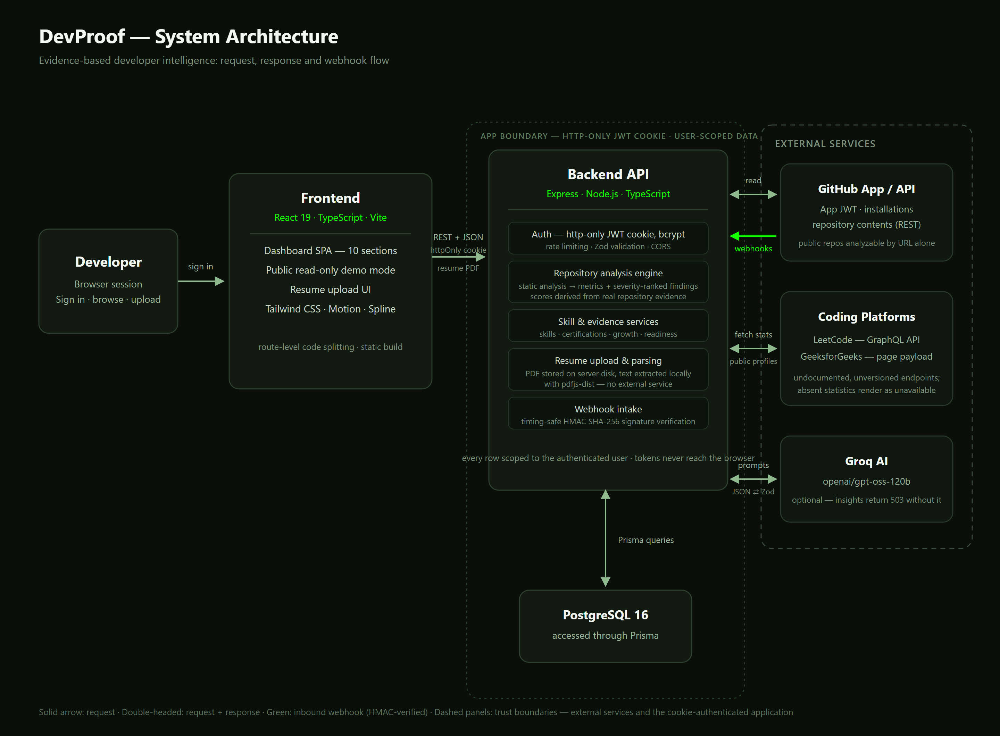

# DevProof

**Developer Intelligence Backed by Evidence, Not Claims.**

[](https://github.com/IshaanSaxena2005/DevProof/actions/workflows/ci.yml)


DevProof turns real engineering activity — GitHub repositories and their
analysis findings, coding-platform profiles, skills, certifications,
hackathons, and a parsed resume — into a structured, evidence-backed
developer-intelligence profile.

Instead of asking what a developer *says* they can do, DevProof shows what
their work demonstrates. Every number on screen is one of three honest kinds,
and the interface never blurs them:

- **Measured** — repository-analysis metrics and findings, coding-platform
  statistics fetched from LeetCode and GeeksforGeeks, growth and readiness
  scores computed from stored evidence.
- **Provided** — certifications, hackathons, claimed skills, and resume
  content the user entered themselves, labelled as such.
- **Generated** — AI insights produced only from stored analyses, validated
  before rendering, and absent (not invented) when no evidence exists.

Connect → Analyze → Verify → Improve → Prove.

## Project Overview

A developer's engineering ability is distributed across platforms: GitHub
shows code, coding platforms show problem-solving, certifications and
hackathons show learning, and a resume shows claims. DevProof consolidates
these signals into one profile where skills are derived from evidence,
scores trace back to individual findings, and unavailable data reads as
unavailable — never as a fabricated zero.

The product is a full-stack TypeScript application: a React SPA with a
public read-only demo, an Express API with GitHub App integration and
webhook intake, PostgreSQL persistence through Prisma, and an optional
Groq-powered insight layer.

## Live Demo

A public, read-only demo of every dashboard section runs with synthetic,
on-screen-labelled sample data — no account, no backend, no real personal
data:

```bash
git clone https://github.com/IshaanSaxena2005/DevProof.git
cd DevProof/Frontend && npm install && npm run dev
# open http://localhost:5173/demo
```

A hosted deployment URL is not recorded in this repository; the demo above
is the verified way to walk the product. See [Demo Mode](#demo-mode) for how
its isolation is enforced.

## Table of Contents

- [Key Features](#key-features)
- [Product Screenshots](#product-screenshots)
- [System Architecture](#system-architecture)
- [Technology Stack](#technology-stack)
- [Security and Authentication](#security-and-authentication)
- [Project Structure](#project-structure)
- [Local Development and Setup](#local-development-and-setup)
- [Environment Variables](#environment-variables)
- [API Overview](#api-overview)
- [Demo Mode](#demo-mode)
- [Testing and CI](#testing-and-ci)
- [Deployment](#deployment)
- [Contributing](#contributing)
- [Authors](#authors)
- [License](#license)

## Key Features

Every row below exists in the code today. The **Kind** column keeps the
positioning honest: what DevProof measured, what the user provided, and what
the AI layer generated.

| Feature | Description | Kind |
|---|---|---|
| **Authentication & sessions** | Email/password with bcrypt hashing; JWT session in an HTTP-only cookie; session restored on refresh | Provided |
| **GitHub App sign-in** | Authorize and install are separate steps — signing in grants no repository access until the user installs the App and picks repositories; client ids are validated (`Iv1.`/`Iv23`) | Provided |
| **Repository sync** | Connect, sync and disconnect GitHub repositories per installation, without duplicating rows | Measured |
| **Repository analysis engine** | Static analysis scores six categories (documentation, testing, security, code quality, maintainability, dependency health) into metrics plus severity-ranked findings; un-analyzed repositories read “Analysis Pending”, never a fabricated score | Measured |
| **Developer 360** | One aggregated view of repositories, analyses, skills, credentials and target roles | Measured |
| **Skills intelligence** | Skills derived from repository evidence and certifications on a claimed → learned → proven ladder; self-reported records never outrank measured ones | Mixed |
| **LeetCode & GeeksforGeeks sync** | Public profile statistics fetched per platform; statistics a platform does not publish render as unavailable, never as zero | Measured |
| **Problem-solving activity** | 26-week submission heatmap, difficulty donut, activity chart and streaks derived from platform calendars | Measured |
| **Certifications** | CRUD records that promote skills up the evidence ladder | Provided |
| **Hackathons** | Self-reported participation records; by design they never promote a skill | Provided |
| **Resume upload & analysis** | PDF upload (5 MB max, byte-validated), text extracted locally with `pdfjs-dist`; technologies found in the text are reported for confirmation, never written as skills automatically | Provided |
| **Growth analytics** | History reconstructed from stored timestamps — months without measurements are omitted, not back-filled | Measured |
| **Career readiness** | Weighted requirement checklists computed on read from stored evidence; every point names the requirement it came from | Measured |
| **AI insights** | Groq-backed summary of strengths, risks and recommendations, grounded only in stored analyses, Zod-validated before rendering; with no evidence the model is never called | Generated |
| **Account & platform management** | Settings page for profile updates, data export, account deletion, and GitHub / coding-platform connections | Provided |
| **Public demo mode** | Every dashboard section with synthetic, labelled fixtures; writes are refused before any request is sent | Synthetic |
| **Responsive dashboard** | Ten route-split lazy-loaded sections, overflow-free at 390 px (browser-tested) | — |

## Product Screenshots

The fastest way to see the product is the [live local demo](#live-demo). The
captured screenshot set is being assembled against the running stack; every
planned shot and what must be visible in it is tracked in
[docs/screenshots.md](docs/screenshots.md). As each file lands in
`screenshots/`, it is embedded here with a caption — this section never links
an image that does not exist.

| Planned capture | Shows |
|---|---|
| `01-landing-page` → `02-login-register` | Public site and authentication |
| `03-demo-overview` → `04-dashboard-overview` | Sample data vs. live data |
| `05-repositories` → `06-repository-analysis` | Repository intelligence and findings |
| `07-developer-360` → `08-skills-intelligence` | Aggregation and the evidence ladder |
| `09-problem-solving` → `12-career-readiness` | Activity, learning, growth, readiness |
| `13-ai-insights` → `15-mobile-responsive` | AI layer, settings, 390 px layout |

## System Architecture



*The full diagram, including its arrow legend, lives in
[docs/architecture.svg](docs/architecture.svg) — the editable source the PNG
is rendered from.*

The system has three zones, drawn apart on purpose:

- **Client** — the React SPA is the only thing in the browser. It holds no
  tokens: the session is an HTTP-only cookie the browser attaches
  automatically, and every dashboard page is a lazy-loaded chunk fetched on
  navigation.
- **Application boundary** — the Express API plus PostgreSQL sit behind
  cookie authentication; every database row is scoped to the authenticated
  user, and repository access is per GitHub App installation. The backend
  owns auth, the analysis engine, skill/evidence services, resume storage and
  local PDF parsing.
- **External services** — GitHub (App REST reads plus inbound webhooks
  verified with a timing-safe HMAC SHA-256 comparison), LeetCode and
  GeeksforGeeks (public statistics from undocumented endpoints), and Groq
  (optional insight generation).

Data moves one way per request: the browser asks the API, the API queries
Prisma, and only the API talks outward — an external service never reaches
the database or the browser directly.

## Technology Stack

Versions below are read from the lockfiles — nothing is listed because it
merely “would fit”.

| Layer | Technology | Role |
|---|---|---|
| UI | React 19, TypeScript (strict) | Component model and type safety across both apps |
| Build | Vite 8 | Dev server and production bundler; `--mode e2e` builds the browser-test bundle |
| Styling | Tailwind CSS 4, custom glass-panel design tokens | Utility styling and the dark dashboard theme |
| Routing | React Router 7 | Route tables shared between `/dashboard` and `/demo` |
| Animation | Motion (`motion/react`), Lucide icons, Spline | Entrance animations, iconography, WebGL landing background |
| API | Node.js 20+, Express 4, TypeScript | HTTP server, routing, middleware pipeline |
| Validation | Zod | Request schemas and AI-response validation |
| Security | bcryptjs, jsonwebtoken, Helmet, CORS, express-rate-limit | Hashing, sessions, headers, origin policy, throttling |
| Logging | Morgan + Winston | Request and application logging |
| Data | PostgreSQL 16, Prisma ORM 5 | Persistence, migrations, typed queries |
| Files | Multer (uploads), `pdfjs-dist` (local text extraction) | Resume intake and parsing without external services |
| Integrations | GitHub App (REST + webhooks), LeetCode GraphQL, GeeksforGeeks page payloads, Groq (`openai/gpt-oss-120b`) | Evidence sources and the optional AI layer |
| Testing | node:test (service + integration), Playwright (20 browser journeys) | Unit, over-HTTP integration, and real-browser coverage |
| Delivery | Docker Compose, GitHub Actions CI | Local full stack and per-push verification |

<!-- next-section -->
