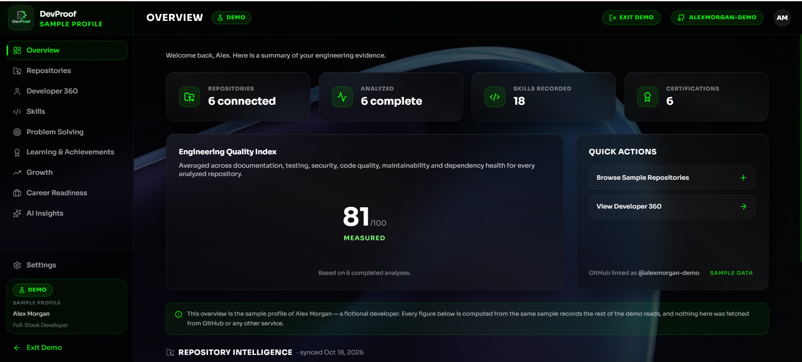
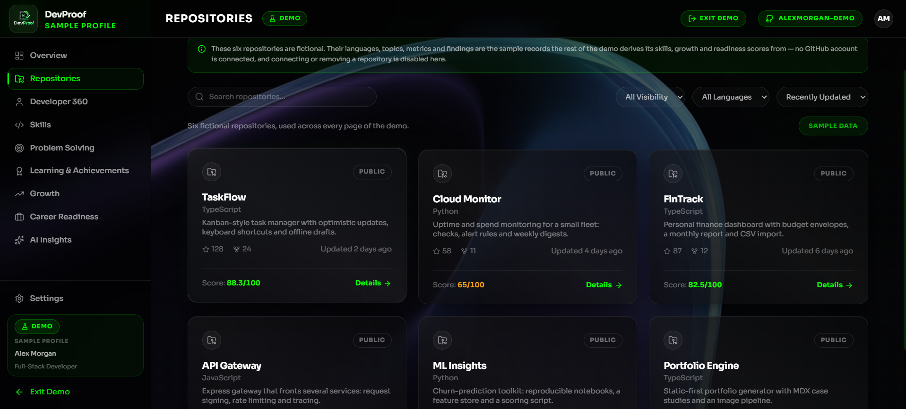
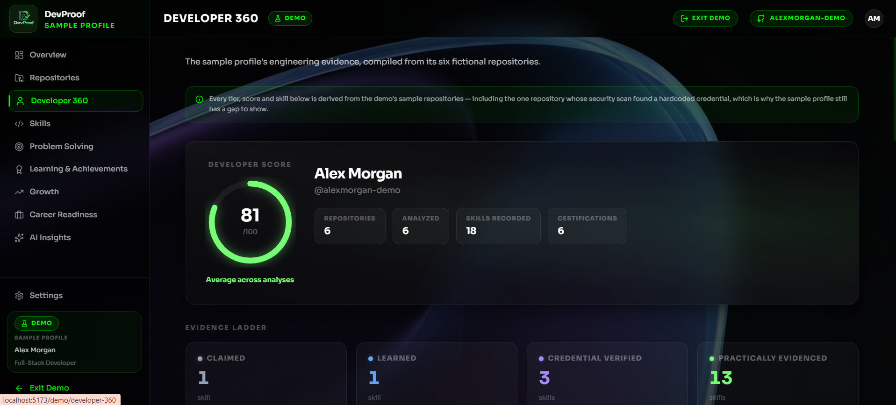
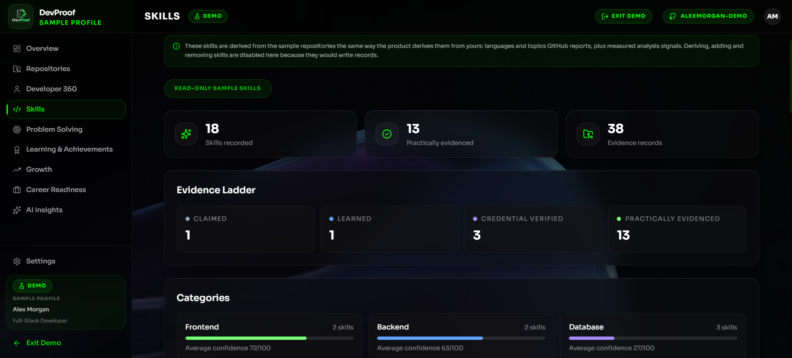
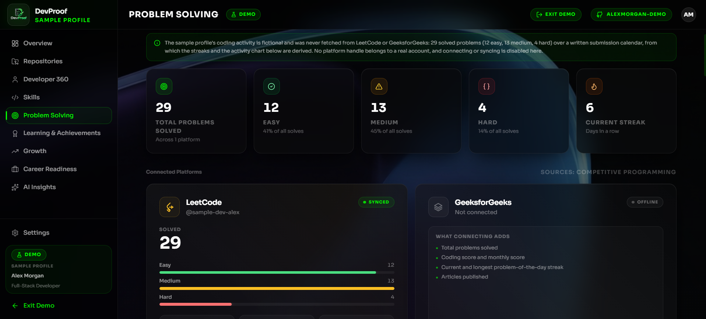
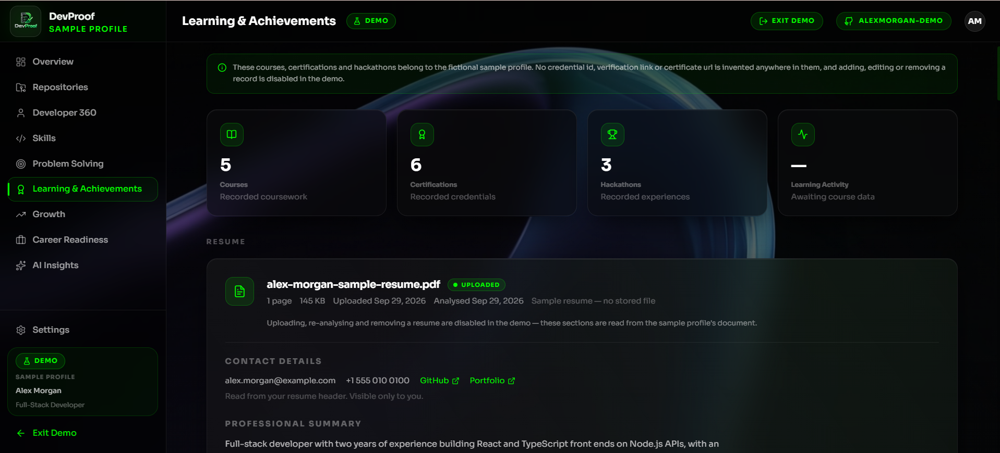
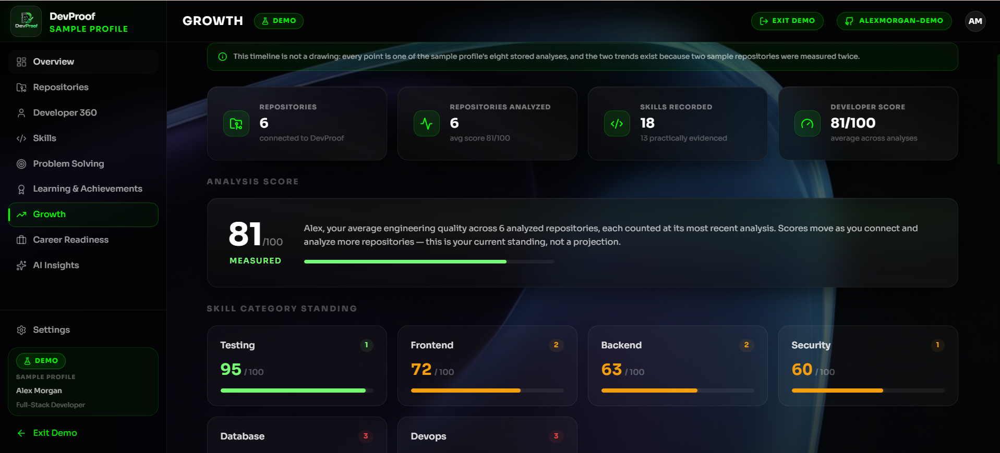
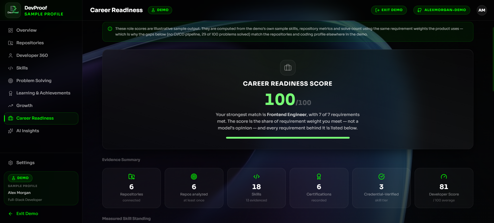
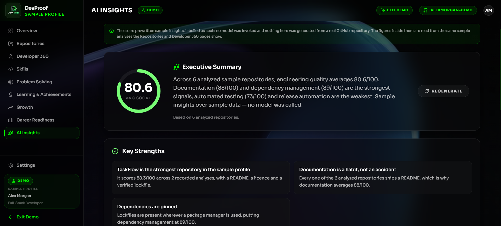
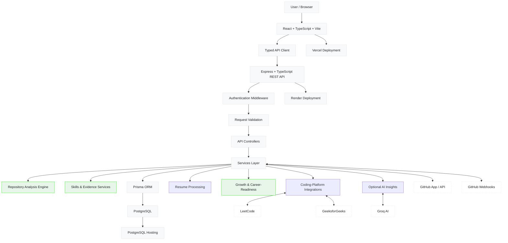

# DevProof

**Developer Intelligence Backed by Evidence, Not Claims.**

[](https://github.com/IshaanSaxena2005/DevProof/actions/workflows/ci.yml)


DevProof transforms real engineering activity — GitHub repositories, coding-platform profiles, certifications, hackathons, and parsed resumes — into a structured, evidence-backed developer intelligence profile.

Instead of asking what a developer _claims_ they can do, DevProof shows what their work demonstrates. Every metric is one of three honest kinds, clearly distinguished in the interface:

- **Measured** — repository analysis metrics, coding-platform statistics fetched from LeetCode and GeeksforGeeks, growth and readiness scores computed from stored evidence
- **Provided** — certifications, hackathons, claimed skills, and resume content entered by the user, labelled as such
- **Generated** — AI insights produced only from stored analyses, validated before rendering, and absent (not invented) when no evidence exists

**Live Demo:** [devproof-project.vercel.app](https://devproof-project.vercel.app/)  
**GitHub Repository:** [github.com/IshaanSaxena2005/DevProof](https://github.com/IshaanSaxena2005/DevProof)  
**Production API:** [devproof-api-elvz.onrender.com](https://devproof-api-elvz.onrender.com/)  
**Health Status:** [api/v1/health](https://devproof-api-elvz.onrender.com/api/v1/health)

---

## Quick Overview

DevProof consolidates distributed engineering signals into one profile where skills are derived from evidence, scores trace back to individual findings, and unavailable data reads as unavailable — never as a fabricated zero.

The product is a full-stack TypeScript application:

- **Frontend:** React SPA with route-split lazy loading, public read-only demo mode, and a dark glassmorphism dashboard design
- **Backend:** Express API with GitHub App integration, webhook intake, PostgreSQL persistence through Prisma, and an optional Groq-powered insight layer
- **Analysis Engine:** Static analysis scoring six categories (documentation, testing, security, code quality, maintainability, dependency health) with severity-ranked findings

---

## Table of Contents

- [Product Screenshots](#product-screenshots)
- [System Architecture](#system-architecture)
- [Key Features](#key-features)
- [ATS Resume Intelligence](#ats-resume-intelligence)
- [Data Flow & Evidence](#data-flow--evidence)
- [Technology Stack](#technology-stack)
- [Security & Authentication](#security--authentication)
- [Project Structure](#project-structure)
- [Local Development](#local-development)
- [Environment Variables](#environment-variables)
- [API Overview](#api-overview)
- [Testing & CI](#testing--ci)
- [Production Deployment](#production-deployment)
- [Contributing](#contributing)
- [Authors](#authors)
- [License](#license)

---

## Product Screenshots

### 1. Landing Page


_The public landing page with the interactive Spline background and primary actions._

### 2. Dashboard Overview



_A consolidated view of developer intelligence, repository metrics, and activity signals._

### 3. Repositories



_Connected GitHub repositories with synchronization status and analysis triggers._

### 4. Developer 360



_Aggregated view of repositories, skills, credentials, and target roles._

### 5. Skills



_Skills with evidence ladder showing claimed, learned, and proven levels._

### 6. Problem Solving



_Activity heatmap, difficulty distribution, and coding-platform statistics._

### 7. Learning & Achievements



_Certifications, hackathons, and resume panel._

### 8. Growth



_Growth history charts reconstructed from stored analysis timestamps._

### 9. Career Readiness



_Readiness score with per-requirement evidence and recommendations._

### 10. AI Insights



_Groq-backed insights grounded in stored analyses, or honest empty state._

---

## System Architecture



### Architecture Explanation

**Frontend/Backend Boundary:** The React SPA is the only code running in the browser. It holds no tokens — the session is an HTTP-only cookie the browser attaches automatically. All dashboard pages are lazy-loaded chunks fetched on navigation.

**Authentication & Session Handling:** Email/password uses bcrypt hashing; GitHub uses a GitHub App flow (not OAuth App) where client IDs are validated (`Iv1.`/`Iv23` prefix). Sessions are single JWTs in HTTP-only, SameSite cookies. Tokens never reach the frontend.

**Persistence:** PostgreSQL stores all application data through Prisma ORM. Every repository, analysis, skill, certification, and credential row is scoped to one authenticated user. Cross-account reads are blocked at the API layer.

**External Integrations:**

- GitHub: App REST reads plus inbound webhooks verified with timing-safe HMAC SHA-256
- LeetCode & GeeksforGeeks: Public statistics fetched from undocumented endpoints
- Groq: Optional AI insight generation; unset key means the endpoint returns a clear 503

**Evidence-Based Data Flow:** Source data → validation/ingestion → persistence → repository analysis/metric calculation → evidence & skill derivation → developer profile & dashboards → optional AI explanations. Unavailable data remains unavailable rather than being invented.

---

## Key Features

Every feature below exists in the code today. The **Kind** column keeps the positioning honest.

| Feature                           | Description                                                                                                                                                                                                | Kind      |
| --------------------------------- | ---------------------------------------------------------------------------------------------------------------------------------------------------------------------------------------------------------- | --------- |
| **Authentication & sessions**     | Email/password with bcrypt hashing; JWT session in HTTP-only cookie; session restored on refresh                                                                                                           | Provided  |
| **GitHub App sign-in**            | Authorize and install are separate steps; client IDs validated (`Iv1.`/`Iv23`); access tokens stay server-side                                                                                             | Provided  |
| **Repository sync**               | Connect, sync, and disconnect GitHub repositories per installation without duplicating rows                                                                                                                | Measured  |
| **Repository analysis engine**    | Static analysis scores six categories (documentation, testing, security, code quality, maintainability, dependency health) with severity-ranked findings; un-analyzed repositories read "Analysis Pending" | Measured  |
| **Developer 360**                 | One aggregated view of repositories, analyses, skills, credentials, and target roles                                                                                                                       | Measured  |
| **Skills intelligence**           | Skills derived from repository evidence and certifications on a claimed → learned → proven ladder; self-reported records never outrank measured ones                                                       | Mixed     |
| **LeetCode & GeeksforGeeks sync** | Public profile statistics fetched per platform; statistics a platform does not publish render as unavailable, never as zero                                                                                | Measured  |
| **Problem-solving activity**      | 26-week submission heatmap, difficulty donut, activity chart, and streaks derived from platform calendars                                                                                                  | Measured  |
| **Certifications**                | CRUD records that promote skills up the evidence ladder                                                                                                                                                    | Provided  |
| **Hackathons**                    | Self-reported participation records; by design they never promote a skill                                                                                                                                  | Provided  |
| **Resume upload & analysis**      | PDF upload (5 MB max, byte-validated), text extracted locally with `pdfjs-dist`; technologies found in text are reported for confirmation, never written as skills automatically                           | Provided  |
| **ATS Resume Intelligence**       | Deterministic, versioned scoring across seven weighted categories (ungraded categories are excluded, never zeroed), evidence-grounded strengths and weaknesses, prioritised recommendations, keyword intelligence over the shared skill taxonomy, and job-description matching — every claim traceable to lines the parser actually read | Measured  |
| **Growth analytics**              | History reconstructed from stored timestamps — months without measurements are omitted, not back-filled                                                                                                    | Measured  |
| **Career readiness**              | Weighted requirement checklists computed on read from stored evidence; every point names the requirement it came from                                                                                      | Measured  |
| **AI insights**                   | Groq-backed summary of strengths, risks, and recommendations, grounded only in stored analyses, Zod-validated before rendering; with no evidence the model is never called                                 | Generated |
| **Account & platform management** | Settings page for profile updates, data export, account deletion, and GitHub/coding-platform connections                                                                                                   | Provided  |
| **Public demo mode**              | Every dashboard section with synthetic, labelled fixtures; writes are refused before any request is sent                                                                                                   | Synthetic |
| **Responsive dashboard**          | Ten route-split lazy-loaded sections, overflow-free at 390px (browser-tested)                                                                                                                              | —         |

### Dashboard heading convention

Every dashboard screen shows its page title exactly once, as the shared header's `h1`. Pages own everything below it: their subtitle (`PageContainer`) and real section headings — `h2` for section labels, `h3` for blocks inside them. The label components (`SLabel`, `SectionLabel`, `LALabel`, `BlockLabel`, …) are heading elements styled by their Tailwind classes; preflight makes a heading inherit the surrounding font metrics, so converting a label changed markup, never appearance. Value-captioning micro-labels inside cards stay paragraphs — they caption a value, they do not name a section. The shell also starts its tab order with a skip link onto the scrollable main region. The whole shape is pinned by `Frontend/test/pageTitles.test.mts`, `Frontend/test/headingSemantics.test.mts`, and the `Frontend/e2e/headings.spec.ts` journey.

---

## ATS Resume Intelligence

The resume feature grades the document the way common applicant-tracking systems read it: deterministically over the parsed text, with every claim traceable to a line the parser actually read. The analysis is computed in the same server-side pass as the structured resume analysis (stored as `parsed.ats`), versioned by `methodologyVersion`, and rendered as the resume card's primary surface — the raw extracted content it is grounded in sits behind a disclosure rather than leading the view.

### Score categories and calculation

Seven weighted categories contribute to a 0–100 total:

| Category    | Weight | What it grades |
| ----------- | -----: | -------------- |
| Parsing     |    10 | Whether the file could be read and routed at all |
| Sections    |    25 | Presence and completeness of the sections a parser routes on (summary, skills, experience, education, …) |
| Contact     |    15 | Machine-findable contact details and profile links in the header |
| Keywords    |    20 | Technology and concept coverage against the shared skill taxonomy |
| Structure   |    15 | Entry shape a parser can segment: roles, organisations, readable dates |
| Credentials |    10 | Certifications as parseable records |
| Formatting  |     5 | Date consistency, bullet structure, standard section headings |

The overall score is the weighted mean of the categories that have input: a category with nothing to grade (no dated roles, no certifications) is **excluded and shown as "not graded"** — never scored as zero. Changing any weight or rule requires bumping `ATS_METHODOLOGY_VERSION`, and the score states its own basis in the UI: it is not issued by any ATS vendor and does not predict shortlisting.

### Findings and recommendations

Strengths and weaknesses derive from the same checks, each carrying the evidence lines it was derived from; every weakness ships with a concrete fix. Recommendations are ordered high → medium → low and de-duplicated across checks, so one underlying issue is never listed twice.

### Keyword matching methodology

Keywords come from the shared skill taxonomy (the list behind the Skills page) plus a fixed concept list, matched over the resume's sectioned text; each hit records which sections it appeared in and how often. Matching is literal and case-insensitive — there is no semantic embedding. Taxonomy skills render as filled chips, concepts as dashed ones, and nothing here is ever written to the user's skills: these are claims from the document, not evidence.

### Job-description matching methodology

`POST /resume/match` reads a pasted posting (40–20,000 characters, validated server-side, discarded after the comparison), extracts required/preferred skills, experience years, education and certification signals, and compares them against the same sectioned text. The match score is a weighted mean — 60 required skills / 15 preferred / 15 stated experience / 10 anchoring of matched terms inside experience or project text — excluding parts with no input; with no readable requirements, no score is produced at all. A requirement the document does not state renders as **"not stated in your resume"**, never as a capability the candidate lacks, and same-category related terms are shown as context but never counted as a match.

### Known limitations

- PDF-only, text-based PDFs: scanned, encrypted or image-only files reach the parse-error state — the file is kept and downloadable, and nothing is fabricated from it.
- Matching is deterministic keyword-and-evidence comparison, not semantic parsing or proficiency assessment; it predicts nothing about interview outcomes.
- Records uploaded before this feature carry no ATS analysis until **Re-analyse** re-reads the stored file.
- The public demo shows the resume section without an ATS analysis (the sample document has none — fabricating one would contradict the feature's premise), and the job-description panel requires a signed-in session with a stored resume.

---

## Data Flow & Evidence

DevProof turns activity into evidence through a clear pipeline:

1. **Source Data** — GitHub repositories (via App REST + webhooks), LeetCode/GeeksforGeeks public profiles, user-provided certifications/hackathons, uploaded resumes
2. **Validation & Ingestion** — Zod schemas on every mutating endpoint; GitHub client ID validation; webhook signature verification; resume byte validation
3. **Persistence** — PostgreSQL through Prisma ORM; every row scoped to authenticated user; migrations tracked and applied
4. **Repository Analysis** — Static analysis engine scores six categories with severity-ranked findings; un-analyzed repos never show fabricated scores
5. **Evidence & Skill Derivation** — Skills derived from repository evidence and certifications on an evidence ladder; self-reported claims never outrank measured evidence
6. **Developer Profile & Dashboards** — Aggregated views (Developer 360, Growth, Career Readiness) computed on read from stored evidence
7. **Optional AI Explanations** — Groq-backed insights grounded only in stored analyses; Zod-validated before rendering; absent when no evidence exists

**What Can and Cannot Be Inferred:**

- Repository findings are generated by the implemented analysis engine
- Coding-platform metrics depend on data those platforms expose (GFG has no difficulty breakdown, which is rendered as unavailable)
- Certifications and hackathons are user-provided and never independently verified
- AI insights are grounded in available evidence and should not replace measured values
- Unavailable data must remain unavailable rather than being invented

---

## Technology Stack

Versions are read from lockfiles — nothing is listed because it merely "would fit."

| Layer            | Technology                                                                                                | Role                                                                           |
| ---------------- | --------------------------------------------------------------------------------------------------------- | ------------------------------------------------------------------------------ |
| **UI**           | React 19, TypeScript (strict)                                                                             | Component model and type safety across both apps                               |
| **Build**        | Vite 8                                                                                                    | Dev server and production bundler; `--mode e2e` builds the browser-test bundle |
| **Styling**      | Tailwind CSS 4, custom glass-panel design tokens                                                          | Utility styling and dark dashboard theme                                       |
| **Routing**      | React Router 7                                                                                            | Route tables shared between `/dashboard` and `/demo`                           |
| **Animation**    | Motion (`motion/react`), Lucide icons, Spline                                                             | Entrance animations, iconography, WebGL landing background                     |
| **API**          | Node.js 20+, Express 4, TypeScript                                                                        | HTTP server, routing, middleware pipeline                                      |
| **Validation**   | Zod                                                                                                       | Request schemas and AI-response validation                                     |
| **Security**     | bcryptjs, jsonwebtoken, Helmet, CORS, express-rate-limit                                                  | Hashing, sessions, headers, origin policy, throttling                          |
| **Logging**      | Morgan + Winston                                                                                          | Request and application logging                                                |
| **Data**         | PostgreSQL 16, Prisma ORM 5                                                                               | Persistence, migrations, typed queries                                         |
| **Files**        | Multer (uploads), `pdfjs-dist` (local text extraction)                                                    | Resume intake and parsing without external services                            |
| **Integrations** | GitHub App (REST + webhooks), LeetCode GraphQL, GeeksforGeeks page payloads, Groq (`openai/gpt-oss-120b`) | Evidence sources and optional AI layer                                         |
| **Testing**      | node:test (service + integration), Playwright (23 browser journeys)                                       | Unit, over-HTTP integration, and real-browser coverage                         |
| **Delivery**     | Docker Compose, GitHub Actions CI                                                                         | Local full stack and per-push verification                                     |

---

## Security & Authentication

Verified implementation behavior — each item exists in the code today:

| Control                 | Implementation                                                                                                                                 |
| ----------------------- | ---------------------------------------------------------------------------------------------------------------------------------------------- |
| **Password storage**    | bcrypt hashes; plaintext passwords never stored or logged                                                                                      |
| **Session**             | Single JWT in HTTP-only, SameSite cookie — never in `localStorage` or `sessionStorage`; tokens never sent to frontend                          |
| **GitHub sign-in**      | GitHub **App** flow: client ID validated (`Iv1.`/`Iv23` prefix); access tokens stay server-side; repositories enumerated per installation      |
| **Data scoping**        | Every repository, analysis, skill, and credential row is owned by one authenticated user; cross-account reads blocked at API                   |
| **Request validation**  | Zod schemas on every mutating endpoint; field-level errors returned                                                                            |
| **Transport hardening** | Helmet security headers; credentialed CORS restricted to configured frontend origin                                                            |
| **Rate limiting**       | 200 requests / 15 min per IP on `/api`, plus dedicated 10 attempts / 15 min budget on password login                                           |
| **Webhook intake**      | GitHub payloads verified with timing-safe HMAC SHA-256 comparison; unverifiable payload refused with 503                                       |
| **Resume privacy**      | PDFs validated by content (not declared type), stored server-side under gitignored `uploads/` with generated filenames; text extracted locally |
| **Demo isolation**      | Demo routes sit outside auth guard; API client refuses every write before request sent; demo renders only synthetic sample identity            |
| **Secrets**             | Everything sensitive arrives via environment variables; `.env` files gitignored; templates carry placeholders only                             |

**Known Limitations:**

- Session is one JWT with fixed lifetime (7 days default) and no refresh-token endpoint
- Rate limiters key on client IP: behind reverse proxy set `TRUST_PROXY` to hop count
- LeetCode and GeeksforGeeks read from undocumented, unversioned endpoints; upstream shape change degrades statistics rather than crashing sync
- Live GitHub OAuth, real webhook deliveries, and live Groq responses need real credentials and are covered by tests over same code paths — not by live round trips

---

## Project Structure

```text
DevProof/
├── Frontend/                 # React SPA, public demo, browser E2E suite
│   ├── src/
│   │   ├── components/       # Landing sections, dashboard primitives, state blocks
│   │   ├── pages/            # Login + dashboard sections (one folder per section)
│   │   │   └── dashboard/ps/ # Problem-solving logic as pure .mts modules
│   │   ├── layouts/          # DashboardLayout (sidebar, header, video background)
│   │   ├── context/          # AuthContext
│   │   ├── demo/             # Demo routes, shell, synthetic fixtures
│   │   ├── services/         # Typed API clients
│   │   └── lib/              # API client, useResource, shared types
│   ├── e2e/                  # Playwright journeys (per-run generated credentials)
│   ├── test/                 # node --test suites over extracted logic
│   └── Dockerfile
│
├── Backend/                  # Express API
│   ├── prisma/               # schema.prisma + committed migrations
│   ├── src/
│   │   ├── controllers/  routes/  services/
│   │   ├── middlewares/  validators/  config/  utils/
│   ├── test/                 # Service tests (Prisma stubbed) + integration over HTTP
│   └── Dockerfile
│
├── docs/                     # Architecture diagram (SVG + PNG)
├── screenshots/              # Product captures
├── docker-compose.yml        # Full stack: postgres + backend + frontend
└── package.json              # Root scripts delegating into Backend/Frontend
```

**Where to look:**

- Frontend pages: `Frontend/src/pages/dashboard/`
- Reusable components: `Frontend/src/components/`
- API clients: `Frontend/src/services/`
- Backend controllers/services: `Backend/src/controllers/`, `Backend/src/services/`
- Prisma schema: `Backend/prisma/schema.prisma`
- Migrations: `Backend/prisma/migrations/`
- Tests: `Backend/test/`, `Frontend/test/`, `Frontend/e2e/`
- CI workflows: `.github/workflows/`
- Architecture docs: `docs/`
- Screenshots: `screenshots/`

---

## Local Development

### Prerequisites

Node.js 20+, npm, Docker Desktop, Git.

### 1. Clone and Configure

```bash
git clone https://github.com/IshaanSaxena2005/DevProof.git
cd DevProof

cp Backend/.env.example Backend/.env      # then set JWT_SECRET (required)
# Frontend/.env is optional — API client defaults to localhost:5000
```

Generate the one required secret:

```bash
node -e "console.log(require('crypto').randomBytes(48).toString('hex'))"
# paste the output as JWT_SECRET in Backend/.env
```

All other variables are optional integrations — see [Environment Variables](#environment-variables).

### 2. Start Full Stack with Docker

```bash
docker compose up -d --build
```

This starts PostgreSQL, the backend (healthchecked against `/api/v1/health`), and the frontend, in that order.

### 3. Or Run Apps on Host

```bash
cd Backend
docker compose up -d        # just PostgreSQL — host port 5434, not 5432
npm install
npm run prisma:migrate       # apply all committed migrations
npm run dev                  # http://localhost:5000
```

```bash
cd Frontend
npm install
npm run dev                  # http://localhost:5173
```

Open http://localhost:5173 — register an account, or explore the public demo at http://localhost:5173/demo without one.

### After Every Pull

Three things can arrive with a pull, each failing at runtime with an error that doesn't name its cause:

```bash
cd Backend
npm install                 # new dependencies
npx prisma migrate deploy   # new migrations
npx prisma generate         # regenerate the client
```

Root-level shortcuts (`npm run dev:backend`, `dev:frontend`, `build`, `test`, `docs:check`) delegate into the two apps and the documentation validator.

### Troubleshooting

| Symptom                                                        | Cause                                                  | Fix                                                                                    |
| -------------------------------------------------------------- | ------------------------------------------------------ | -------------------------------------------------------------------------------------- |
| Backend exits on start; connection refused                     | Postgres not running, or wrong port                    | `cd Backend && docker compose up -d` — local port is **5434**                          |
| `Cannot find module …` after a pull                            | New dependency                                         | `cd Backend && npm install`                                                            |
| Missing table/column after a pull                              | New migration or stale client                          | `npx prisma migrate deploy && npx prisma generate`                                     |
| `DATABASE_URL is required` at boot                             | `Backend/.env` missing                                 | Copy `Backend/.env.example` to `Backend/.env` and set `JWT_SECRET`                     |
| "GitHub OAuth is not configured…" or bounce to `/login?error=` | OAuth-App credentials where **GitHub App** is required | Use GitHub App client id (`Iv1.` / `Iv23`); OAuth-App ids rejected on purpose          |
| AI Insights returns 503                                        | `GROQ_API_KEY` unset                                   | Set it — or ignore it; rest of app works without it                                    |
| Landing loads but every dashboard request fails                | Backend not running or wrong API URL                   | Start backend; point `Frontend/.env` (`VITE_API_URL`) at it if not on `localhost:5000` |

---

## Environment Variables

Both apps ship a template — copy `Backend/.env.example` to `Backend/.env` and fill in values. Only two are required; every optional integration degrades cleanly (clear error at call time, never startup crash).

### Backend — `Backend/.env`

| Variable                                    | Required | Purpose                                                                                                                                       |
| ------------------------------------------- | -------- | --------------------------------------------------------------------------------------------------------------------------------------------- |
| `DATABASE_URL`                              | ✅       | PostgreSQL connection string (local compose: port **5434**)                                                                                   |
| `JWT_SECRET`                                | ✅       | Session-token signing key, minimum 8 characters — generate with `node -e "console.log(require('crypto').randomBytes(48).toString('hex'))"`    |
| `PORT`                                      | no       | API port (default `5000`)                                                                                                                     |
| `NODE_ENV`                                  | no       | `development` / `production` / `test`                                                                                                         |
| `JWT_EXPIRES_IN`                            | no       | Session lifetime (default `7d`)                                                                                                               |
| `GITHUB_CLIENT_ID` / `GITHUB_CLIENT_SECRET` | no       | GitHub **App** sign-in; id must start with `Iv1.` or `Iv23` — anything else rejected                                                          |
| `GITHUB_CALLBACK_URL`                       | no       | OAuth callback registered on App (default `http://localhost:5000/api/v1/auth/github/callback`)                                                |
| `GITHUB_APP_ID` / `GITHUB_PRIVATE_KEY`      | no       | App-authenticated calls (installation enumeration, App JWT). Key is App's `.pem` content pasted verbatim — literal `\n` escapes will not work |
| `GITHUB_APP_SLUG`                           | no       | Only shapes "install DevProof" link                                                                                                           |
| `GITHUB_WEBHOOK_SECRET`                     | no       | Shared HMAC secret you invent and paste into App's webhook settings; without it every webhook refused with 503                                |
| `FRONTEND_URL`                              | no       | CORS origin (default `http://localhost:5173`)                                                                                                 |
| `TRUST_PROXY`                               | no       | Proxy hop count (positive integer, usually `1`) when TLS terminates in front of API; empty when directly exposed — `true` never accepted      |
| `GROQ_API_KEY`                              | no       | Enables AI insights; unset means clear 503 on that endpoint only                                                                              |
| `GROQ_MODEL`                                | no       | Model override (default `openai/gpt-oss-120b`)                                                                                                |

### Frontend — `Frontend/.env`

| Variable       | Required | Purpose                                                        |
| -------------- | -------- | -------------------------------------------------------------- |
| `VITE_API_URL` | no       | Backend base URL; falls back to `http://localhost:5000/api/v1` |

Never commit `.env` files, OAuth secrets, JWT secrets, or API keys — all are gitignored, and committed templates carry placeholders only.

---

## API Overview

All routes are mounted under `/api/v1`. Endpoints marked **(auth)** require the session cookie; everything else is public or webhook-authenticated.

| Group                       | Endpoints                                                                                                                                                                                                      |
| --------------------------- | -------------------------------------------------------------------------------------------------------------------------------------------------------------------------------------------------------------- |
| **Health**                  | `GET /health`                                                                                                                                                                                                  |
| **Auth**                    | `POST /auth/register`, `POST /auth/login`, `POST /auth/logout`, `GET /auth/me` (auth), `GET /auth/github`, `GET /auth/github/callback`, `POST /auth/github/sync` (auth), `POST /auth/github/disconnect` (auth) |
| **Repositories (auth)**     | `GET /repositories`, `GET /repositories/github`, `GET /repositories/:id`, `POST /repositories/connect`, `POST /repositories/sync`, `DELETE /repositories/:id`                                                  |
| **Analysis (auth)**         | `POST /analysis/trigger`, `GET /analysis/repo/:repositoryId`, `GET /analysis/:id`                                                                                                                              |
| **Developer 360 (auth)**    | `GET /developer360/overview`                                                                                                                                                                                   |
| **Skills (auth)**           | `GET /skills`, `POST /skills`, `POST /skills/derive`, `DELETE /skills/:id`                                                                                                                                     |
| **Certifications (auth)**   | `GET /certifications`, `POST /certifications`, `PATCH /certifications/:id`, `DELETE /certifications/:id`                                                                                                       |
| **Hackathons (auth)**       | `GET /hackathons`, `POST /hackathons`, `PATCH /hackathons/:id`, `DELETE /hackathons/:id`                                                                                                                       |
| **Coding profiles (auth)**  | `GET /coding-profiles`, `POST /coding-profiles`, `POST /coding-profiles/:platform/sync`, `DELETE /coding-profiles/:platform` — platform is `LEETCODE` or `GEEKSFORGEEKS`                                       |
| **Growth (auth)**           | `GET /growth/history`                                                                                                                                                                                          |
| **Career readiness (auth)** | `GET /career/readiness`                                                                                                                                                                                        |
| **Resume (auth)**           | `GET /resume`, `POST /resume` (multipart field `resume`; PDF only, 5 MB max), `GET /resume/download`, `POST /resume/analyse`, `POST /resume/match` (JSON `jobDescription`, 40–20,000 chars, never persisted), `DELETE /resume` |
| **AI (auth)**               | `GET /ai/insights`                                                                                                                                                                                             |
| **Webhooks**                | `POST /webhooks/github` (HMAC-verified), `GET /webhooks/github/status`                                                                                                                                         |

> **Note on Courses:** A courses subsystem (`/courses` CRUD with skill promotion) still exists in the codebase — including a mounted route group — but it is **designated for removal** and therefore excluded from this documentation and the feature list. Removing it cleanly requires dropping the `Course` model, its migrations, service, validator, tests, and the Learning page section; that has not been done yet, and this README does not pretend otherwise.

Request constraints: resumes are PDF-only and validated by bytes; matched job descriptions are length-bounded (40–20,000 characters) and never stored; coding-profile usernames are fetched before anything is written (invalid or private handle leaves no row); every mutation is Zod-validated with field-level errors.

---

## Testing & CI

Four stages of testing, all executed locally against current source as part of this documentation pass:

| Suite                   | Count | What it proves                                                                                                                                                                                                    |
| ----------------------- | ----- | ----------------------------------------------------------------------------------------------------------------------------------------------------------------------------------------------------------------- |
| **Backend service**     | 186   | Business rules with Prisma stubbed: skill derivation and confidence ceilings, certification matching, LeetCode/GFG mapping, growth arithmetic, readiness scoring, resume validation, deterministic ATS scoring/findings/recommendations, keyword and job matching, webhook signature handling |
| **Backend integration** | 47    | Real HTTP stack over real PostgreSQL: anonymous callers rejected on every protected route, field-level validation errors, cross-user isolation, skill promotion end to end, job-description matching over the caller's own resume |
| **Frontend**            | 76    | Extracted logic under `node --test`: UTC date handling, difficulty fallbacks, demo fixtures and isolation, API-client envelope, page render-state rules, page-title and heading-semantics invariants              |
| **Browser E2E**         | 23    | Playwright Chromium against production build + compiled backend: auth journeys, every dashboard section, demo mode, mocked repository flows, 390px overflow, console cleanliness, heading hierarchy and skip link |

```bash
cd Backend  && npm test          # builds, then service + integration suites
cd Frontend && npm test          # node --test over .mts sources
cd Frontend && npm run test:e2e  # builds e2e bundle, runs Playwright
```

**Isolation guarantees:** Integration tests use dedicated `<database>_test` schema derived from your `DATABASE_URL`; browser suite runs against dropped-and-recreated `devproof_e2e_test` database on port 5399 with GitHub and Groq disabled; E2E account passwords generated per run and never committed.

**GitHub Actions CI** (`.github/workflows/ci.yml`) runs five jobs on every push and pull request to `main`:

- **docs** — link, anchor, and image validation
- **backend** — migrations on empty disposable Postgres, schema-drift check, build + 233 tests, production-dependency audit
- **frontend** — typecheck, build, 76 tests, audit
- **browser E2E** — 23 journeys
- **docker** — both images build

**What automated suite does not prove:** Live GitHub OAuth, GitHub App installation flow, real webhook delivery, and live Groq responses need real credentials and stay outside CI — same code paths exercised with stubs, which is not the same as live round trip.

---

## Production Deployment

**Current Deployment State:**

- **Frontend:** Deployed to **Vercel** at [devproof-project.vercel.app](https://devproof-project.vercel.app/)
- **Backend:** Hosted on **Render** at [devproof-api-elvz.onrender.com](https://devproof-api-elvz.onrender.com/)
- **Database:** PostgreSQL hosted separately
- **Health Status:** [api/v1/health](https://devproof-api-elvz.onrender.com/api/v1/health) — confirmed healthy with connected database at time of check

**Configuration:**

- Vercel serves the frontend as a static build
- Render hosts the backend API
- `VITE_API_URL` points to production API base URL
- `FRONTEND_URL` controls allowed frontend origin for CORS
- `GITHUB_CALLBACK_URL` must match callback configured in GitHub App
- Secrets configured on backend host (Render environment variables)
- Redeployment needed when applicable environment changes made

**What deployment existence does not prove:** The health endpoint was confirmed healthy with a connected database, but this alone does not prove that GitHub OAuth, repository sync, every dashboard endpoint, or all external integrations work in production. Live end-to-end validation requires real credentials and manual testing.

---

## Contributing

1. Branch from `main` (`git checkout -b fix/short-description`)
2. Keep commits conventional (`feat:`, `fix:`, `test:`, `docs:`, `ci:`)
3. Behavior changes need tests; both suites must pass locally (`cd Backend && npm test`, `cd Frontend && npm test`)
4. Add migrations with `npx prisma migrate dev` and commit generated migration folder — never edit an already-applied migration
5. Open a pull request; CI re-runs migrations, tests, builds, dependency audit, and Docker builds before anything merges

---

## Authors

**Ishaan Saxena**  
[LinkedIn](https://www.linkedin.com/in/ishaan-saxena2005/) · [GitHub](https://github.com/IshaanSaxena2005)

**Hardesh Agarwal**  
[LinkedIn](https://www.linkedin.com/in/hardesh-agarwal/) · [GitHub](https://github.com/kinghardesh)

Built with a focus on evidence-based developer intelligence.

---

## License

DevProof is proprietary software developed by **Hardesh Agarwal and Ishaan Saxena**. Unauthorized copying, redistribution, modification, or commercial use is not permitted without prior written permission from the copyright holder. (The repository does not currently carry a standalone `LICENSE` file; the terms above are the project's statement of record.)

Third-party libraries, frameworks, APIs, fonts, icons, and services remain subject to their respective licenses.
